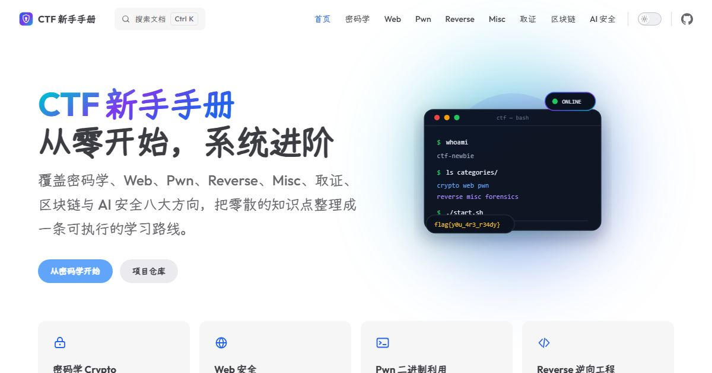

<div align="center">



# CTF Handbook

[](README.md) [](README.en.md) [](README.ja.md)

A systematic, beginner-friendly CTF handbook. Start from zero, progress step by step.

[Website](https://docs.sajunan.cn/en/) · [Crypto Handbook](https://docs.sajunan.cn/en/crypto/) · [Issues](https://github.com/sajunan/docs.sajunan.cn/issues) · [简体中文](README.md) · [日本語](README.ja.md)

[](https://docs.sajunan.cn)
[](https://vitepress.dev)
[](LICENSE-CONTENT.md)

</div>

## What is this

This project is a CTF handbook organized by category, written for people who are new to CTF and want a structured path.

Articles start from first principles, include reproducible code and explain the toolchain instead of only giving answers. The Crypto handbook is available now; other categories are being written.

## Categories

| Category | Topics | Status |
|----------|--------|--------|
| [Crypto](https://docs.sajunan.cn/en/crypto/) | Classical ciphers, symmetric crypto, RSA, ECC, hashing, protocols, side channels, post-quantum crypto | Available |
| [Web Security](https://docs.sajunan.cn/en/web/) | SQL injection, XSS, SSRF, SSTI, deserialization, authentication bypass | In progress |
| [Pwn](https://docs.sajunan.cn/en/pwn/) | Stack overflows, format strings, heap exploitation, ROP, sandbox escapes | In progress |
| [Reverse Engineering](https://docs.sajunan.cn/en/reverse/) | Static analysis, dynamic debugging, unpacking, algorithm recovery | In progress |
| [Misc](https://docs.sajunan.cn/en/misc/) | Encoding, steganography, traffic analysis, general tricks | In progress |
| [Forensics](https://docs.sajunan.cn/en/forensics/) | Disk, memory, logs and file forensics | In progress |
| [Blockchain](https://docs.sajunan.cn/en/blockchain/) | Smart contract bugs, EVM and on-chain security | In progress |
| [AI Security](https://docs.sajunan.cn/en/ai/) | Prompt injection, jailbreaks, adversarial examples, agent security | In progress |

## Tech stack

| Technology | Version | Purpose |
|------------|---------|---------|
| [VitePress](https://vitepress.dev) | `2.0.0-alpha.21` | Static site generator |
| [Vue 3](https://vuejs.org) | 3.x | Theme and components |
| TypeScript | 5.x | Type checking |
| pnpm | 12.x | Package management and workspace |
| Outfit / Yozai / JetBrains Mono | - | Latin, CJK and code fonts, self-hosted |
| GitHub Actions | - | Build checks |

The site also includes local search, a sitemap, Open Graph metadata, dark mode, mobile support and Chinese typography improvements.

## Quick start

### 1. Requirements

- [Node.js](https://nodejs.org) 22 or newer
- [Git](https://git-scm.com)
- pnpm 12 (Corepack is recommended)

```bash
node -v
corepack enable pnpm
pnpm -v
```

### 2. Clone the repository

```bash
git clone https://github.com/sajunan/docs.sajunan.cn.git
cd docs.sajunan.cn
```

### 3. Install dependencies

```bash
pnpm install
```

### 4. Build the VitePress runtime

This repository keeps the VitePress source, so compile it once before the first run:

```bash
pnpm tsdown
```

You only need to repeat this when changing files under `src/`.

### 5. Start the dev server

```bash
pnpm -F=docs dev
```

Open http://localhost:5173/ . Markdown and theme changes hot-reload automatically.

## Build and preview

```bash
pnpm tsdown
pnpm -F=docs build
```

The output is written to `docs/.vitepress/dist/`.

Preview the production build locally:

```bash
pnpm -F=docs preview
```

The default address is http://localhost:4173/ .

## Deployment

The repository includes `netlify.toml`:

| Setting | Value |
|---------|-------|
| Build command | `pnpm tsdown && pnpm -F=docs build` |
| Publish directory | `docs/.vitepress/dist` |
| Node version | 24 |

Cloudflare Pages, Vercel or a self-hosted server can use the same build command and output directory.

## Project structure

| Path | Purpose |
|------|---------|
| `docs/` | Site content: all articles and pages |
| `docs/.vitepress/` | Site config, theme and styles |
| `docs/public/` | Images, fonts and filing icons |
| `docs/crypto/` | Crypto articles |
| `docs/web/`, `docs/pwn/`, ... | Other CTF categories |
| `docs/en/` | English site content |
| `docs/ja/` | Japanese site content |
| `src/` | VitePress source and default theme |
| `scripts/` | Build and type-generation scripts |
| `types/` | TypeScript declarations |
| `bin/` | VitePress CLI entry |
| `.github/` | GitHub Actions build check |
| `netlify.toml` | Netlify deployment config |

The root `package.json` builds the VitePress source. `docs/package.json` builds the site.

## Adding an article

1. Create a Markdown file in the right category, for example `docs/web/sql-injection.md`
2. Add frontmatter:

```md
---
title: SQL Injection Basics
description: A short description of the article
---
```

3. Add it to the `sidebar` in `docs/.vitepress/config.ts` if needed
4. Run `pnpm -F=docs dev` to check the result
5. Run `pnpm -F=docs build` before committing

A category landing page is `docs/<category>/index.md`, for example `docs/crypto/index.md`.

## FAQ

**`pnpm` is not found**

```bash
corepack enable pnpm
```

**Port already in use**

```bash
pnpm -F=docs dev --port 5180
```

**Changes under `src/` are not reflected**

```bash
pnpm tsdown
pnpm -F=docs dev
```

**Where do I change navigation, sidebar or SEO?**

`docs/.vitepress/config.ts`.

**Where do I change fonts or colors?**

`docs/.vitepress/theme/styles.css`.

## Easter eggs

There are a few hidden things in the console, the page source, a hidden page and an arcade command. Try to find them.

## License

- Source code: MIT License, see [LICENSE](LICENSE)
- Articles and images: © 2026 Inui Sajuna, see [LICENSE-CONTENT.md](LICENSE-CONTENT.md)
- Third-party fonts and dependencies: see [THIRD-PARTY-NOTICES.md](THIRD-PARTY-NOTICES.md) and [docs/public/fonts/OFL.txt](docs/public/fonts/OFL.txt)

## Credits

Built with [VitePress](https://vitepress.dev). Thanks to Vue, Vite, Fontsource and Yozai.
