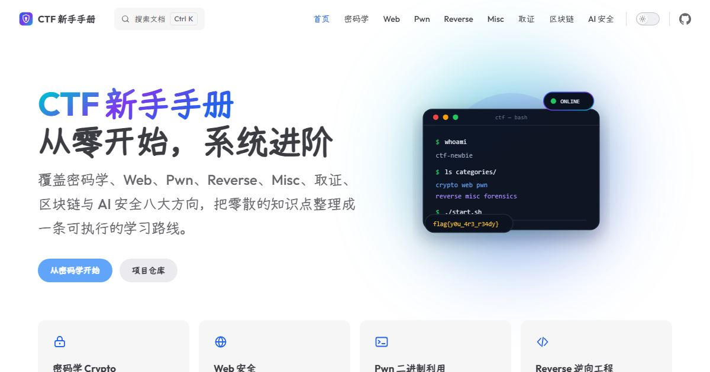

<div align="center">



# CTF 初心者ハンドブック

[](README.md) [](README.en.md) [](README.ja.md)

CTF 初心者向けの体系的な学習ハンドブック。ゼロから始め、体系的にステップアップします。

[サイト](https://docs.sajunan.cn/ja/) · [暗号入門](https://docs.sajunan.cn/ja/crypto/) · [問題報告](https://github.com/sajunan/docs.sajunan.cn/issues) · [简体中文](README.md) · [English](README.en.md)

[](https://docs.sajunan.cn)
[](https://vitepress.dev)
[](LICENSE-CONTENT.md)

</div>

## これは何か

これは CTF の分野ごとに構成された学習ハンドブックで、対象読者は CTF に触れたばかりで体系的に学びたい初心者です。

内容は基礎原理から解説し、再現可能なコードとツールチェーンを添えています。結論やスクリプトだけを示すことはしません。現在、暗号分野は整理が完了しており、その他の分野も継続的に追加していきます。

## コンテンツ分野

| 分野 | 概要 | 状態 |
|------|------|------|
| [暗号 Crypto](https://docs.sajunan.cn/ja/crypto/) | 古典暗号、共通鍵暗号、RSA、ECC、ハッシュ、プロトコル、サイドチャネル、耐量子暗号 | 公開中 |
| [Web セキュリティ](https://docs.sajunan.cn/ja/web/) | SQL インジェクション、XSS、SSRF、SSTI、デシリアライゼーション、認証バイパス | 制作中 |
| [Pwn バイナリエクスプロイト](https://docs.sajunan.cn/ja/pwn/) | スタックオーバーフロー、フォーマット文字列、ヒープ悪用、ROP、サンドボックス脱出 | 制作中 |
| [Reverse リバースエンジニアリング](https://docs.sajunan.cn/ja/reverse/) | 静的解析、動的デバッグ、アンパック、アルゴリズム復元 | 制作中 |
| [Misc その他](https://docs.sajunan.cn/ja/misc/) | エンコード、ステガノグラフィ、トラフィック解析、総合テクニック | 制作中 |
| [フォレンジック Forensics](https://docs.sajunan.cn/ja/forensics/) | ディスク、メモリ、ログ、ファイルのフォレンジック | 制作中 |
| [ブロックチェーン Blockchain](https://docs.sajunan.cn/ja/blockchain/) | スマートコントラクトの脆弱性、EVM、オンチェーンセキュリティ | 制作中 |
| [AI セキュリティ](https://docs.sajunan.cn/ja/ai/) | プロンプトインジェクション、ジェイルブレイク、敵対的サンプル、Agent セキュリティ | 制作中 |

## 技術スタック

| 技術 | バージョン | 用途 |
|------|-----------|------|
| [VitePress](https://vitepress.dev) | `2.0.0-alpha.21` | 静的サイトジェネレーター |
| [Vue 3](https://vuejs.org) | 3.x | テーマとコンポーネント |
| TypeScript | 5.x | 型チェック |
| pnpm | 12.x | パッケージ管理と workspace |
| Outfit / Yozai / JetBrains Mono | - | 欧文・中国語・コード用フォント。すべてセルフホスト |
| GitHub Actions | - | 自動ビルドチェック |

サイトにはローカル検索、Sitemap、Open Graph、ダークモード、モバイル対応、中国語組版の最適化も含まれています。

## クイックスタート

### 1. 環境の準備

以下をインストールする必要があります：

- [Node.js](https://nodejs.org) 22 以上
- [Git](https://git-scm.com)
- pnpm 12（Corepack での有効化を推奨）

```bash
node -v
corepack enable pnpm
pnpm -v
```

### 2. コードの取得

```bash
git clone https://github.com/sajunan/docs.sajunan.cn.git
cd docs.sajunan.cn
```

### 3. 依存関係のインストール

```bash
pnpm install
```

### 4. VitePress ランタイムコードのビルド

本リポジトリは VitePress のソースコードを保持しているため、初回起動前に一度コンパイルする必要があります：

```bash
pnpm tsdown
```

その後、`docs/` 配下の記事を変更する際に再実行する必要はありません。再コンパイルが必要なのは `src/` を変更した場合だけです。

### 5. ローカル開発サーバーの起動

```bash
pnpm -F=docs dev
```

ブラウザで http://localhost:5173/ を開きます。Markdown やテーマファイルを変更すると自動的にホットリロードされます。

## ビルドとプレビュー

本番用の静的ファイルを生成します：

```bash
pnpm tsdown
pnpm -F=docs build
```

ビルド結果は `docs/.vitepress/dist/` に出力されます。

ビルド結果をローカルでプレビューします：

```bash
pnpm -F=docs preview
```

デフォルトのアドレスは http://localhost:4173/ です。

## デプロイ

リポジトリには `netlify.toml` が同梱されており、Netlify の設定は以下のとおりです：

| 設定項目 | 値 |
|--------|-----|
| Build command | `pnpm tsdown && pnpm -F=docs build` |
| Publish directory | `docs/.vitepress/dist` |
| Node version | 24 |

Cloudflare Pages、Vercel、または自前のサーバーを使う場合も、ビルドコマンドと出力ディレクトリは同じです。

## ディレクトリ構成

| パス | 役割 |
|------|------|
| `docs/` | サイトのコンテンツ。すべての記事とページがここにあります |
| `docs/.vitepress/` | サイト設定、テーマ、スタイル |
| `docs/public/` | 画像、フォント、届出アイコンなどの静的リソース |
| `docs/crypto/` | 暗号分野の記事 |
| `docs/web/`、`docs/pwn/` など | その他の CTF 分野 |
| `docs/ja/` | 日本語サイトのコンテンツ |
| `src/` | VitePress のソースコードとデフォルトテーマ |
| `scripts/` | ビルドや型生成などのスクリプト |
| `types/` | TypeScript の型宣言 |
| `bin/` | VitePress CLI のエントリーポイント |
| `.github/` | GitHub Actions によるビルドチェック |
| `netlify.toml` | Netlify のデプロイ設定 |

ルートの `package.json` は VitePress のソースコードのビルドを担当し、`docs/package.json` はサイト自体を担当します。

## 記事を追加する

1. 対応するカテゴリの下に Markdown ファイルを作成します。例：`docs/web/sql-injection.md`
2. ファイルの先頭に frontmatter を追加します：

```md
---
title: SQL インジェクション入門
description: この記事が何を扱うかを一文で説明
---
```

3. サイドバーに表示したい場合は、`docs/.vitepress/config.ts` の `sidebar` を変更します
4. ローカルで `pnpm -F=docs dev` を実行して表示を確認します
5. コミット前に一度 `pnpm -F=docs build` を実行し、ビルドエラーがないことを確認します

カテゴリのトップページは `docs/<カテゴリ>/index.md` です。例：`docs/crypto/index.md`。

## よくある質問

**`pnpm` コマンドが見つからない**

```bash
corepack enable pnpm
```

**ポートが使用中**

```bash
pnpm -F=docs dev --port 5180
```

**`src/` を変更したのにページが変わらない**

以下を再実行します：

```bash
pnpm tsdown
pnpm -F=docs dev
```

**ナビゲーション、サイドバー、SEO を変更したい**

すべて `docs/.vitepress/config.ts` にあります。

**フォントや色を変更したい**

`docs/.vitepress/theme/styles.css` にあります。

## イースターエッグ

コンソール、ページのソースコード、隠しページ、そしてあるアーケードコマンドの中に何かが仕込まれています。自分で探してみてください。

## ライセンス

- ソースコード：MIT License。[LICENSE](LICENSE) を参照
- 記事、画像などのコンテンツ：© 2026 Inui Sajuna。[LICENSE-CONTENT.md](LICENSE-CONTENT.md) を参照
- サードパーティのフォントと依存関係：[THIRD-PARTY-NOTICES.md](THIRD-PARTY-NOTICES.md) と [docs/public/fonts/OFL.txt](docs/public/fonts/OFL.txt) を参照

## 謝辞

[VitePress](https://vitepress.dev) をベースに構築しています。Vue、Vite、Fontsource、Yozai などのオープンソースプロジェクトに感謝します。
