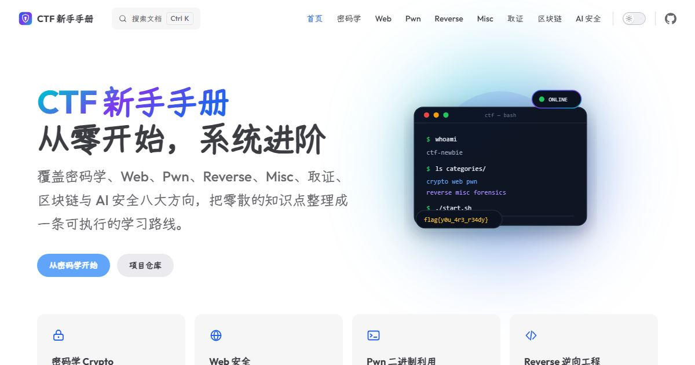

<div align="center">



# CTF 新手手册

面向 CTF 新手的系统化学习手册，从零开始，系统进阶。

[站点](https://docs.sajunan.cn) · [密码学入门](https://docs.sajunan.cn/crypto/) · [问题反馈](https://github.com/NAN8991/docs.sajunan.cn/issues)

[](https://docs.sajunan.cn)
[](https://vitepress.dev)
[](LICENSE-CONTENT.md)

</div>

## 这是什么

这是一个按 CTF 方向组织的学习手册，目标读者是刚接触 CTF、想系统入门的新手。

内容会从基础原理讲起，配合可复现的代码和工具链，而不是只给结论或脚本。目前密码学方向已经整理完成，其余方向会持续补充。

## 内容方向

| 方向 | 简介 | 状态 |
|------|------|------|
| [密码学 Crypto](https://docs.sajunan.cn/crypto/) | 古典密码、对称密码、RSA、ECC、哈希、协议、侧信道与后量子密码 | 已上线 |
| [Web 安全](https://docs.sajunan.cn/web/) | SQL 注入、XSS、SSRF、SSTI、反序列化与认证绕过 | 建设中 |
| [Pwn](https://docs.sajunan.cn/pwn/) | 栈溢出、格式化字符串、堆利用、ROP 与沙箱逃逸 | 建设中 |
| [Reverse](https://docs.sajunan.cn/reverse/) | 静态分析、动态调试、脱壳与算法还原 | 建设中 |
| [Misc](https://docs.sajunan.cn/misc/) | 编码、隐写、流量分析与综合技巧 | 建设中 |
| [Forensics](https://docs.sajunan.cn/forensics/) | 磁盘、内存、日志与文件取证 | 建设中 |
| [Blockchain](https://docs.sajunan.cn/blockchain/) | 智能合约漏洞、EVM 与链上安全 | 建设中 |
| [AI 安全](https://docs.sajunan.cn/ai/) | 提示注入、越狱、对抗样本与 Agent 安全 | 建设中 |

## 技术栈

| 技术 | 版本 | 用途 |
|------|------|------|
| [VitePress](https://vitepress.dev) | `2.0.0-alpha.21` | 静态站点生成器 |
| [Vue 3](https://vuejs.org) | 3.x | 主题与组件 |
| TypeScript | 5.x | 类型检查 |
| pnpm | 12.x | 包管理与 workspace |
| Outfit / Yozai / JetBrains Mono | - | 西文、中文、代码字体，全部自托管 |
| GitHub Actions | - | 自动构建检查 |

站点还包含本地搜索、Sitemap、Open Graph、暗色模式、移动端适配和中文排版优化。

## 快速开始

### 1. 准备环境

需要安装：

- [Node.js](https://nodejs.org) 22 或更高版本
- [Git](https://git-scm.com)
- pnpm 12（推荐用 Corepack 启用）

```bash
node -v
corepack enable pnpm
pnpm -v
```

### 2. 获取代码

```bash
git clone https://github.com/NAN8991/docs.sajunan.cn.git
cd docs.sajunan.cn
```

### 3. 安装依赖

```bash
pnpm install
```

### 4. 构建 VitePress 运行时代码

本仓库保留了 VitePress 源码，第一次启动前需要先编译一次：

```bash
pnpm tsdown
```

之后修改 `docs/` 下的文章时不需要重复执行，只有改动 `src/` 时才需要重新编译。

### 5. 启动本地开发服务器

```bash
pnpm -F=docs dev
```

浏览器打开 http://localhost:5173/ 。修改 Markdown 或主题文件会自动热更新。

## 构建与预览

生成生产静态文件：

```bash
pnpm tsdown
pnpm -F=docs build
```

构建结果在 `docs/.vitepress/dist/`。

本地预览构建结果：

```bash
pnpm -F=docs preview
```

默认地址是 http://localhost:4173/ 。

## 部署

仓库自带 `netlify.toml`，Netlify 配置如下：

| 配置项 | 值 |
|--------|-----|
| Build command | `pnpm tsdown && pnpm -F=docs build` |
| Publish directory | `docs/.vitepress/dist` |
| Node version | 24 |

如果使用 Cloudflare Pages、Vercel 或自己的服务器，构建命令和产物目录相同。

## 目录结构

| 路径 | 作用 |
|------|------|
| `docs/` | 站点内容，所有文章和页面都在这里 |
| `docs/.vitepress/` | 站点配置、主题、样式 |
| `docs/public/` | 图片、字体、备案图标等静态资源 |
| `docs/crypto/` | 密码学方向文章 |
| `docs/web/`、`docs/pwn/` 等 | 其他 CTF 方向 |
| `src/` | VitePress 源码与默认主题 |
| `scripts/` | 构建、生成类型等脚本 |
| `types/` | TypeScript 类型声明 |
| `bin/` | VitePress CLI 入口 |
| `.github/` | GitHub Actions 构建检查 |
| `netlify.toml` | Netlify 部署配置 |

根目录的 `package.json` 负责 VitePress 源码构建，`docs/package.json` 负责站点本身。

## 新增一篇文章

1. 在对应分类下创建 Markdown 文件，例如 `docs/web/sql-injection.md`
2. 在文件顶部加 frontmatter：

```md
---
title: SQL 注入入门
description: 一句话说明这篇文章讲什么
---
```

3. 如果需要出现在侧边栏，修改 `docs/.vitepress/config.ts` 里的 `sidebar`
4. 本地运行 `pnpm -F=docs dev` 检查效果
5. 提交前执行一次 `pnpm -F=docs build`，确认没有构建错误

分类首页是 `docs/<分类>/index.md`，例如 `docs/crypto/index.md`。

## 常见问题

**`pnpm` 命令找不到**

```bash
corepack enable pnpm
```

**端口被占用**

```bash
pnpm -F=docs dev --port 5180
```

**修改了 `src/` 但页面没变化**

重新执行：

```bash
pnpm tsdown
pnpm -F=docs dev
```

**想修改导航、侧边栏、SEO**

都在 `docs/.vitepress/config.ts`。

**想修改字体或颜色**

在 `docs/.vitepress/theme/styles.css`。

## 彩蛋

控制台、页面源码、隐藏页面和一条街机指令里都藏了点东西，自己找找看。

## 许可证

- 源代码：MIT License，见 [LICENSE](LICENSE)
- 文章、图片等内容：© 2026 Inui Sajuna，见 [LICENSE-CONTENT.md](LICENSE-CONTENT.md)
- 第三方字体与依赖：见 [THIRD-PARTY-NOTICES.md](THIRD-PARTY-NOTICES.md) 与 [docs/public/fonts/OFL.txt](docs/public/fonts/OFL.txt)

## 致谢

基于 [VitePress](https://vitepress.dev) 构建，感谢 Vue、Vite、Fontsource、Yozai 等开源项目。
